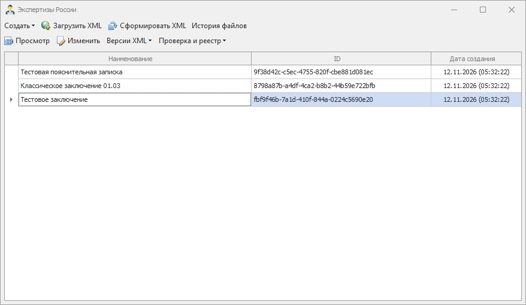

# ProjectDocumentation

«Экспертизы России» — настольное приложение DevExpress для Windows с локальной SQLite. В комплект также входит локальный React-портал для работы с XML.

- **Заключение экспертизы** (`Conclusion`, схема `01.04`) — сведения об экспертной организации, заявителе, объекте, документах, экспертах и выводах. Доступно преобразование заключений `01.00`, `01.02` и `01.03`. Совместимая выгрузка доступна в `01.03`.
- **Пояснительная записка** (`ExplanatoryNote`, схема `01.07`) — сведения об авторах, подписантах, застройщике, объекте и исходных документах. Доступно преобразование записок `01.03` и `01.05`, а также совместимая выгрузка `01.05`.

Запустите `ProjectDocumentation.NET.exe` для работы с локальной базой. В меню «Создать» доступны редакторы 01.04, 01.07 и классические формы 01.03. Полное дерево выбранной записи 01.03 открывается через «Версии XML». При импорте программа определяет вид и версию по содержимому XML. В «Истории файлов» сохраняются итоги импорта и выгрузки вместе с замечаниями проверки.

В настольных редакторах вид «Разделы» использует вкладки и поля DevExpress. Вид «Все поля» открывает дерево XSD с тем же документом. В меню «Проверка и реестр» можно проверить сохранённый XML, открыть внешний валидатор или поиск в ЕГРЗ. Для работы в браузере запустите `Start-Portal.cmd` из полного комплекта.



## Стек

| Компонент | Версия / назначение |
|---|---|
| .NET Framework | 4.7.2, WinForms |
| DevExpress | 24.2 (XtraGrid, XtraBars, XtraLayout, RichEdit) — нужна установленная лицензия |
| DevExpress XPO | ORM для локальной базы SQLite `xml.s3db` |
| System.Data.SQLite | 1.0.119 |
| Dadata | 23.6.1 — подсказки по организациям и нормализация адресов |
| Autoupdater.NET | 1.9.2 — обязательное автообновление |
| XML-сервис | Python, xmlschema и lxml — проверка XSD 1.1, преобразование, предпросмотр XSL |

## Сборка

Собирается только на Windows с Visual Studio или Build Tools и установленным DevExpress 24.2:

```powershell
nuget restore ProjectDocumentation.sln
msbuild ProjectDocumentation.sln /p:Configuration=Release /m
```

Для комплекта с React-порталом и валидатором запустите `.\tools\Build-Release.ps1`. Для отдельного настольного комплекта используйте `.\tools\Build-Release.ps1 -DesktopOnly`. Оба режима запускают тесты XML и помещают результат в `artifacts`. Release-сборку решения для `master` и PR владельца выполняет [Windows CI](docs/WINDOWS_RUNNERS.md).

## Документация

| Документ | О чём |
|---|---|
| [docs/CONCLUSION_01_04.md](docs/CONCLUSION_01_04.md) | Запуск нового редактора, преобразование заключений и сборка комплекта |
| [docs/EXPLANATORY_NOTE_01_07.md](docs/EXPLANATORY_NOTE_01_07.md) | Работа с пояснительными записками 01.07 и преобразование старых XML |
| [docs/architecture.md](docs/architecture.md) | Устройство решения, запуск, хранение данных, поток данных |
| [docs/user-guide.md](docs/user-guide.md) | Работа в приложении: импорт, создание, редактирование, выгрузка |
| [docs/screenshots.md](docs/screenshots.md) | Скриншоты классических форм, актуальных редакторов и веб-портала |
| [docs/code-reference.md](docs/code-reference.md) | Справочник по классам и методам `Core.NET` и `ProjectDocumentation.NET` |
| [docs/review.md](docs/review.md) | Результаты проверки кода: найденные дефекты, риски, рекомендации |

## Правила разработки

Правила работы с git и PR для людей и агентов — в [AGENTS.md](AGENTS.md).
