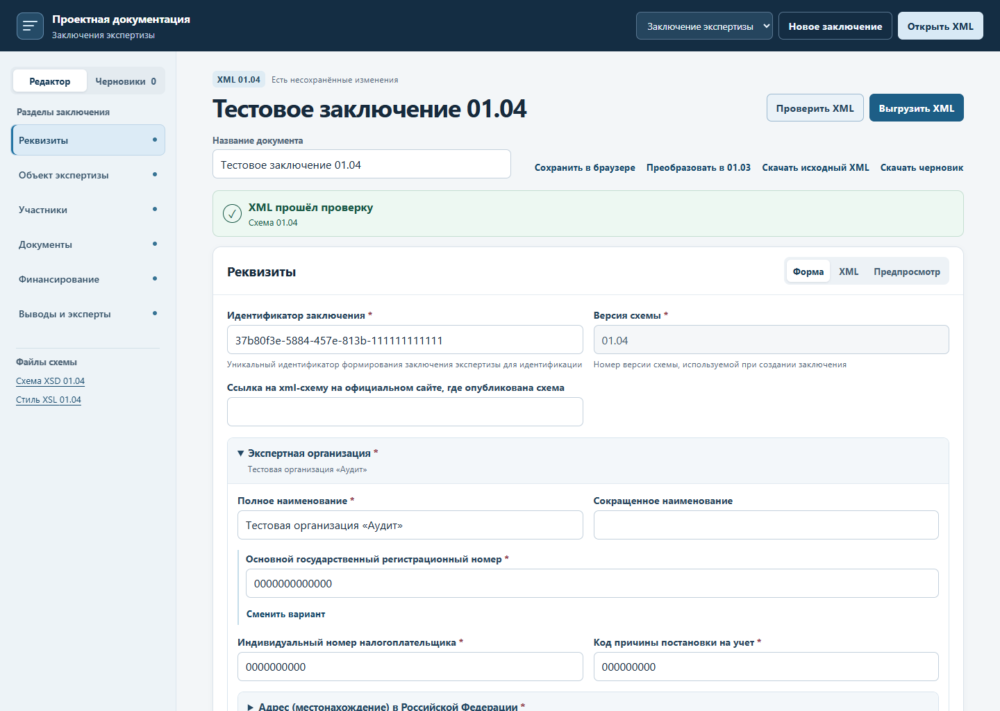
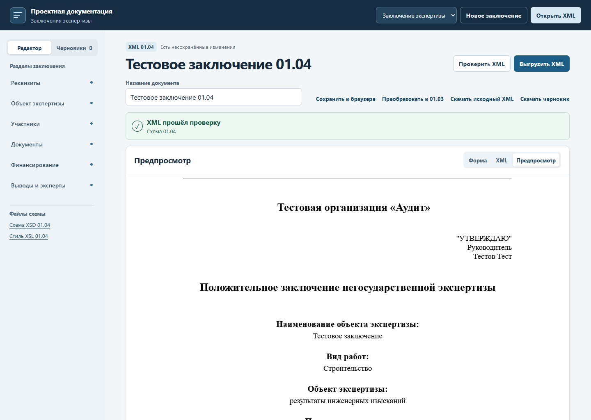

# Заключение экспертизы 01.04

Откройте 01.04 в WinForms или в вебе. Классическая форма DevExpress предназначена для заключений 01.03. В руководстве описаны запуск, перенос базы, переход между формами и команды выгрузки. [Руководство пользователя](user-guide.md)

Перед заполнением соберите реквизиты экспертной организации и участников, сведения об объекте, комплект представленных документов, результаты оценки и данные экспертов. Формулировки, признаки и коды берите из материалов конкретного заключения. В скриншотах руководства показаны тестовые записи.

## Заполнение разделов

| Раздел | Как заполнить и проверить |
|---|---|
| Реквизиты и общие сведения | Проверьте идентификатор и версию XML. Укажите наименование, ОГРН или предусмотренный вариант регистрации организации, ИНН, КПП, адрес и утверждающее лицо. В параметрах экспертизы выберите результат, форму, объект, предмет, стадию и вид работ. Наименование объекта сверяйте с исходной документацией. |
| Объект экспертизы | Внесите адрес, вид и код функционального назначения, кадастровые номера и технико-экономические показатели. Для российского адреса укажите код региона, ОКТМО и наименование муниципального образования. Для каждого выделенного объекта или части заполните применимые поля. Проверьте признаки особой опасности и технической сложности, уникальность, условия площадки и сведения об экологической экспертизе. |
| Участники | Выберите подходящий тип заявителя, проектировщика, застройщика или технического заказчика и заполните его карточку. Разделяйте участников подготовки проектной документации и инженерных изысканий. Если схема требует номер НОПРИЗ, укажите подтверждённый номер для нужного участника. |
| Документы | Добавьте каждую представленную позицию отдельно. Укажите вид, наименование, номер, дату, автора и сведения о файле либо о комплекте, в составе которого документ представлен. Для материалов изысканий проверьте полные реквизиты автора. При повторной экспертизе заполните сведения о ранее выданных заключениях. |
| Финансирование | Укажите источник финансирования и реквизиты, которые раскрывает выбранный вариант. Внесите сметную стоимость и единицы показателей, когда они относятся к заключению. |
| Выводы и эксперты | Заполните результаты оценки изысканий, проектной документации и сметной стоимости в соответствии с предметом экспертизы. Внесите даты, применённые требования, выявленные несоответствия и итоговую формулировку. Для каждого эксперта укажите ФИО, СНИЛС, направление и реквизиты аттестата. |

Часть полей становится обязательной после выбора предмета или стадии экспертизы. Например, для предмета «инженерные изыскания» проверьте сведения об информационной модели отчётной документации. Для проверки проектной документации проверьте сведения о её информационной модели и дату применённых требований. Для повторной экспертизы сверяйте формулировку о совместимости с неизменённой частью документации с исходным заключением.

Для российского адреса сверяйте муниципальное образование по адресу объекта или участника. В поле «Код функционального назначения» введите код вида объекта или его части по классификатору. В поле СНИЛС используйте формат `000-000-000 00` с номером конкретного эксперта. Такой формат проверяется XSD.

## Пример последовательности для изысканий

Чтобы пройти этот сценарий на тестовых данных, откройте образец в редакторе и нажмите «Проверить XML». [Заполненный пример XML](../schema_engine/tests/fixtures/conclusion-01-04.xml)

1. Заполните экспертную организацию и утверждающее лицо. В «Параметрах экспертизы» выберите исходные значения формы, результата и стадии, затем предмет экспертизы по инженерным изысканиям.
2. Внесите сведения об информационной модели отчётной документации и карточки представленных документов. Для каждого файла проверьте CRC32 и принадлежность подписей этому файлу.
3. Заполните объект, российский или зарубежный адрес, сведения об экологической экспертизе, участников и финансирование. Сверьте регион и ОКТМО с адресом.
4. Внесите вывод по результатам инженерных изысканий и сведения об экспертах. В повторном заключении проверьте предыдущие заключения и сведения о применённых требованиях.
5. Нажмите «Проверить XML» и откройте замечания. Например, строка `/Conclusion/ExaminationObject/EngineeringSurveysIM` ведёт к сведениям об информационной модели изысканий. После исправления повторите проверку.
6. Проверьте предпросмотр, сохраните запись в WinForms или выгрузите проверенный XML из веба.





## Преобразование и совместимая копия

- Для заключений 01.00, 01.02 и 01.03 выберите преобразование в 01.04. В WinForms проверенный результат сохраняется как отдельная запись. В вебе просмотрите предупреждения перед открытием результата и скачайте исходный файл.
- После преобразования сверяйте обязательные сведения, которые могли отсутствовать в старом XML. Среди них ОКТМО, СНИЛС, НОПРИЗ, признаки объекта, код функционального назначения и сведения об экологической экспертизе. Если нужных материалов пока нет, сохраните черновик.
- Для передачи в 01.03 выберите «Выгрузить совместимую копию 01.03» в WinForms. В вебе используйте «Преобразовать в 01.03», проверьте замечания и выгрузите результат. Сохраните исходный 01.04 перед преобразованием.

Схемы 01.00 и 01.02 используются для проверки исходного XML. [Архив 01.00](https://minstroyrf.gov.ru/docs/81573/) · [Архив 01.02](https://minstroyrf.gov.ru/tim/xml-skhemy/xml-skhema-zaklyucheniya-ekspertizy/p1_2/)

## Сборка

Для сборки нужны Python 3.11+, Visual Studio Build Tools, .NET Framework 4.7.2 и DevExpress 24.2.5. Полный комплект также использует Node.js 20.19+ или 22.12+.

```powershell
.\tools\Build-Release.ps1
.\tools\Build-Release.ps1 -DesktopOnly
```

Готовые файлы появятся в `artifacts/release-*/desktop`. Среда Python и валидатор входят в архив. Команда с `-DesktopOnly` собирает комплект WinForms. [Запуск портала из исходников](../portal/README.md)
