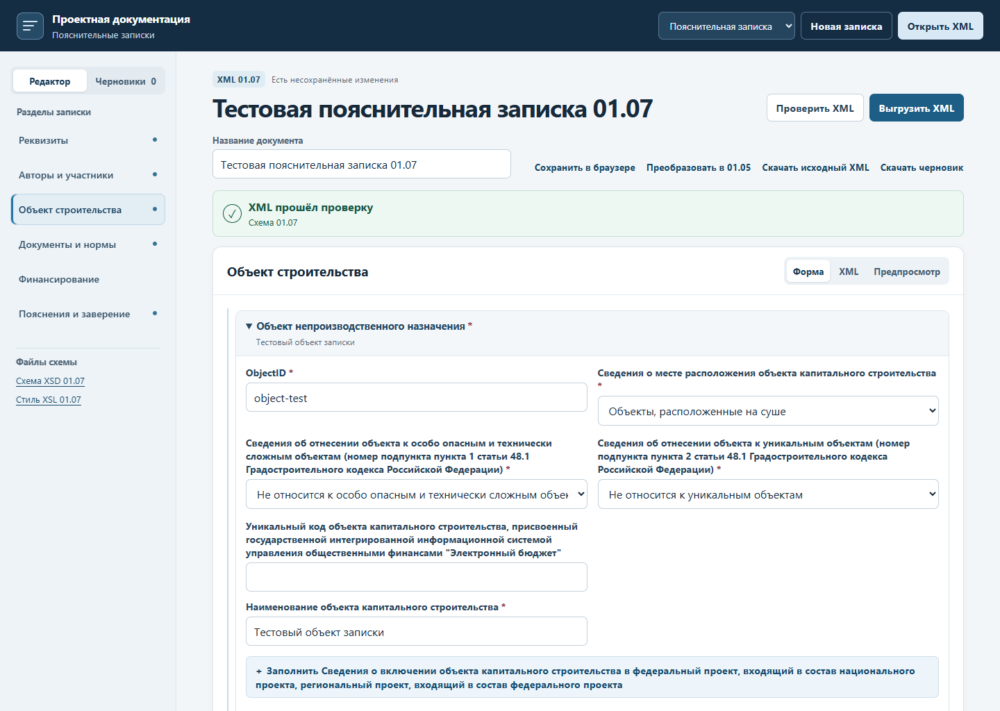
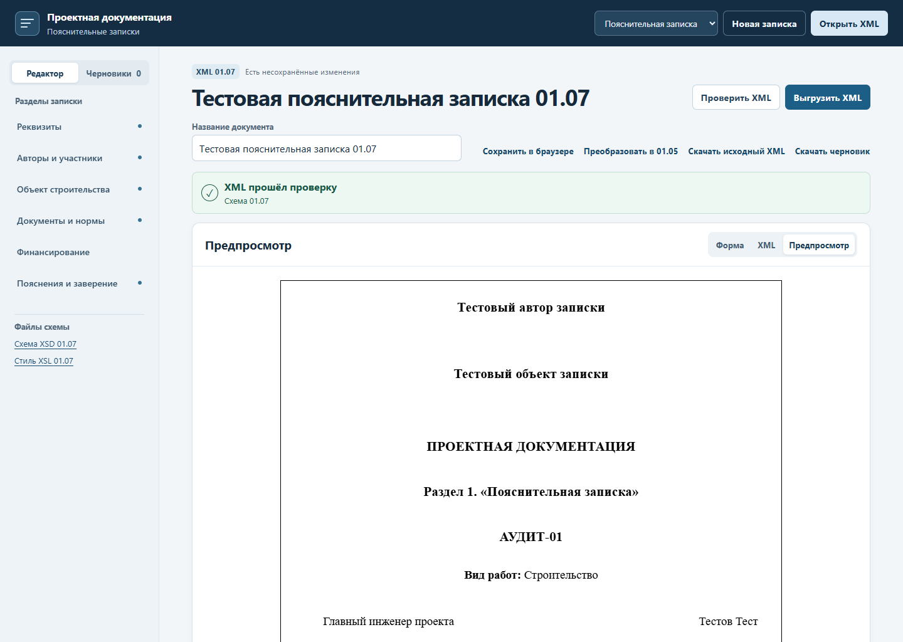

# Пояснительная записка 01.07

Для новой записки нажмите «Добавить пояснительную записку 01.07» в WinForms или выберите «Пояснительная записка» в вебе. При импорте в WinForms выберите тип файла «Пояснительная записка». Веб определяет вид документа по корневому элементу `ExplanatoryNote`. Версия определяется по `SchemaVersion`. Классическая форма DevExpress открывает записки 01.03. [Запуск и действия в редакторах](user-guide.md)

## Заполнение разделов

| Раздел | Как заполнить и проверить |
|---|---|
| Реквизиты | Введите шифр пояснительной записки и год подготовки. Проверьте версию и идентификатор. Добавьте сведения об изменениях, если записка относится к изменённой документации. |
| Авторы и участники | Заполните сведения о лице, подготовившем документацию, авторах проекта, подписантах, застройщике и техническом заказчике. Выберите тип участника. Для ГИП, ГАП и других подписантов заполните предусмотренные формой роль и реквизиты. Сверьте ФИО, СНИЛС и НОПРИЗ по исходным сведениям. |
| Объект строительства | Выберите непроизводственный, производственный или линейный объект по проектной документации. Укажите идентификатор объекта, место расположения, наименование, вид работ и признаки объекта. Заполните адрес и ОКТМО для российского адреса, функциональное назначение, мощность или ТЭП, землю, пожарную безопасность, энергоэффективность и ресурсы в применимых блоках. |
| Документы и нормы | Перечислите применённые нормативные документы. Отдельными строками внесите документы для подготовки проектных решений, исходные документы и отчёты по изысканиям. Проверьте наименование, номер, дату, автора и реквизиты файла, комплекта или ссылки. |
| Финансирование | Заполните источники финансирования, если они предусмотрены материалами проекта. Проверьте значения в выбранном варианте. |
| Пояснения и заверение | Укажите сокращения, дополнительные сведения и пояснения проектировщика при необходимости. Заполните заверение проектировщика. В текстовых блоках можно добавлять текст, таблицы и изображения в нужном порядке. |

В блоке «Разделы проектной документации» проверьте состав разделов по выбранному типу объекта. В каждом предусмотренном месте укажите сведения о подготовленном разделе или выберите «Раздел не разрабатывался», если это соответствует составу проекта. Для повторяемых объектов и частей используйте отдельные идентификаторы. Проверка 01.07 включает ограничения уникальности и целостности ссылок.

## Пример последовательности для непроизводственного объекта

Для проверки заполненной формы откройте тестовый файл, перейдите к объекту строительства и вызовите проверку XML. [Заполненный пример XML](../schema_engine/tests/fixtures/explanatorynote-01-07.xml)

1. Введите шифр и год. Заполните карточку автора и сведения о ГИП. Укажите застройщика и технического заказчика по документам проекта.
2. Добавьте «Объект непроизводственного назначения». Введите его `ObjectID`, место расположения, наименование и вид работ. Выберите признаки особой опасности и технической сложности и уникальности по подтверждённым сведениям. Заполните российский адрес с ОКТМО.
3. Заполните назначение, показатели, категории земель, характеристики ответственности и применимые разделы проекта. Сверьте повторяющиеся коды и ссылки на объекты.
4. Добавьте нормы, документы для подготовки решений, исходно-разрешительные документы и отчёты изысканий. В варианте с файлами проверьте имя, формат и CRC32. Для заменённого файла добавьте относящиеся к нему подписи.
5. Заполните заверение. Если в тексте нужно показать изображение, добавьте соответствующий блок и выберите PNG, JPEG или GIF с диска. Проверьте порядок элементов в предпросмотре.
6. Выполните проверку XML. По сообщениям перейдите к полям, исправьте их и повторите проверку. Сохраните запись или выгрузите готовый XML.

## Переход со старой версии

- Записку 01.03 можно открыть в классическом редакторе WinForms. Команда «Просмотр» в главном окне открывает её исходный XML. Для перехода к новой схеме выберите «Преобразовать записку в 01.07». В вебе откройте её в XML и запустите преобразование. В WinForms проверенный результат сохраняется в отдельной записи.
- Записку 01.05 можно создать, открыть, изменить, сохранить и выгрузить в WinForms в своей версии. Для перехода в 01.07 отдельно выберите «Версии XML» → «Преобразовать записку в 01.07». При проверке откройте замечания о ГИП и его роли, ОКТМО, СНИЛС, НОПРИЗ, признаках объекта, составе разделов и заверении.
- Для передачи в 01.05 выберите «Выгрузить копию записки 01.05» в WinForms. В вебе сохраните актуальную 01.07, преобразуйте рабочий документ в 01.05 и выгрузите после проверки. Сверьте предупреждения о полях, представление которых отличается в целевой схеме.

Записки 01.05 и 01.07 проверяются по XSD соответствующей версии. Для 01.03 используется схема совместимости `explanatorynote-wire-01-03.xsd`. Она проверяет, в частности, шифр, год, выбор одного типа объекта и его наименование. При выгрузке комплектный XSD сохраняется рядом с XML.

Сборка и перенос базы описаны в [инструкции к комплекту](CONCLUSION_01_04.md).
