# Руководство по ProjectDocumentation

[Галерея скриншотов](screenshots.md)

## Запуск и выбор редактора

1. Распакуйте весь архив в отдельный каталог. Держите `ProjectDocumentation.NET.exe`, комплектный `ProjectDocumentation.Schema.exe` и папки из архива вместе.
2. Если переносите документы из прежней установки, закройте обе версии программы. Сохраните резервную копию `xml.s3db` из старого каталога и поместите рабочую копию рядом с новым `ProjectDocumentation.NET.exe`. При первом запуске с пустым каталогом программа создаст новую базу.
3. Для WinForms запустите `ProjectDocumentation.NET.exe`. В полном комплекте для веба запустите `Start-Portal.cmd`. Он откроет `http://127.0.0.1:8765` в браузере. Оставьте окно службы открытым, пока работаете в портале.

| Интерфейс | Какую версию выбрать | Где сохраняется работа |
|---|---|---|
| Классические формы DevExpress | Заключение или пояснительная записка 01.03 | Локальная база `xml.s3db` |
| Современные формы WinForms | Заключение 01.04 или пояснительная записка 01.07 | Локальная база `xml.s3db` после проверки. Незавершённый документ можно сохранить в отдельный XML |
| Веб-редактор | Заключение 01.04, пояснительная записка 01.05 или 01.07 | XML-файлы и сохранённые черновики в текущем браузере |

В вебе заключения 01.00, 01.02 и 01.03 и записка 01.03 открываются во вкладке «XML» для просмотра и преобразования. В WinForms выбор редактора для существующей записи определяется её версией. Заключения 01.00 и 01.02 можно просмотреть и преобразовать в 01.04. Записку 01.05 можно просмотреть и преобразовать в 01.07.

Обмен между вебом и WinForms проходит через XML. Для переноса незавершённой работы сохраните XML-черновик, затем откройте файл в другом редакторе. Для готового документа используйте выгрузку с проверкой схемы.

## Главное окно WinForms

В таблице отображаются документы из SQLite. Выберите запись, чтобы открыть доступные для неё действия. Двойной щелчок открывает редактирование или преобразование в зависимости от версии. Правый щелчок открывает контекстное меню.

- Для импорта нажмите «Загрузить XML», выберите файл, укажите наименование и выберите «Заключение» или «Пояснительная записка» в поле «Тип файла». После нажатия «Сохранить» программа определяет версию XML. При совпадении идентификатора проверьте предложение заменить существующую запись или загрузить копию.
- При импорте заключения 01.03 в базе сохраняются данные элементов исходного XML. Сохраните сам исходный файл отдельно.
- Для новой записи нажмите «Добавить заключение 01.04», «Добавить пояснительную записку 01.07» или выберите команду в меню «Классические формы 01.03». Наименование используется в списке документов.
- Для готового документа выберите строку и нажмите «Сформировать XML». Укажите папку выгрузки. Актуальные документы проверяются по соответствующей XSD.
- Для преобразования или совместимой выгрузки выберите соответствующую команду для строки. Доступность команды определяется видом и версией документа.
- Перед удалением записи проверьте выделенную строку и подтвердите действие в диалоге.

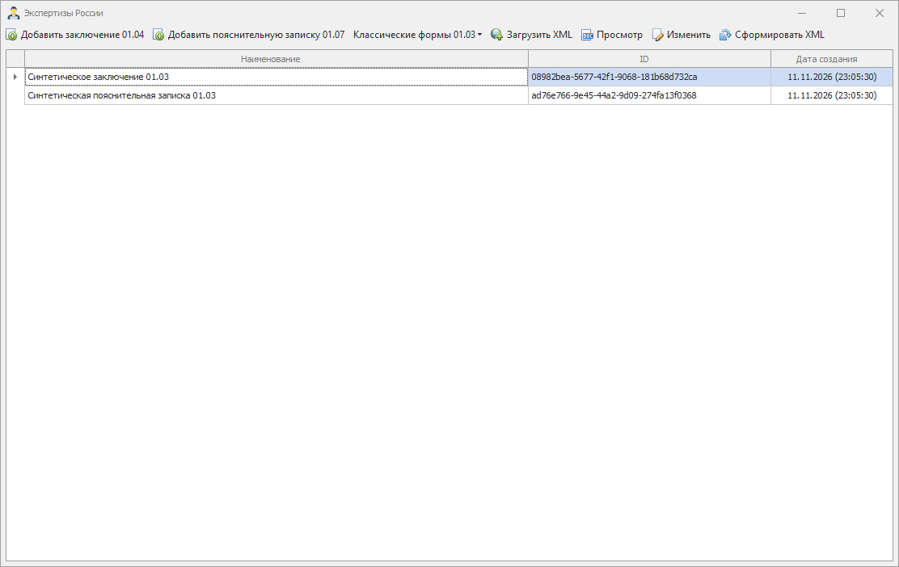

## Классические формы DevExpress 01.03

Откройте меню «Классические формы 01.03» и выберите «Добавить заключение 01.03» или «Добавить пояснительную записку 01.03». Существующую запись этой версии откройте двойным щелчком. В каждой форме проверьте наименование и заполните видимые поля по исходным материалам. В таблицах участников, документов и показателей используйте «Добавить», затем сохраните карточку строки.

| Форма | Порядок заполнения |
|---|---|
| Заключение | Заполните параметры экспертизы, экспертную организацию и утверждающее лицо. Затем внесите заявителя, представленные документы и предыдущие заключения. Проверьте объект, адрес, финансирование, условия, проектировщиков и застройщиков. Завершите разделы оценки, выводов и экспертов. |
| Пояснительная записка | Введите шифр и год. Добавьте лицо, подготовившее документацию, подписантов, застройщика и технического заказчика. Выберите тип объекта и заполните относящиеся к нему поля. Укажите изменения, авторов, нормы, исходные документы и текстовые блоки. |

Если в форме нужно изменить вариант объекта или участника, проверьте список полей после выбора. При сохранении повторяемого блока сначала завершите редактирование его карточки, затем сохраните основной документ.

В текстовом блоке записки нажмите «Таблица», затем откройте добавленную строку кнопкой «Редактировать…». В окне «Таблица» используйте «Добавить столбец» и заполните ячейки в строке «Заголовок». Кнопка «Добавить строку» создаёт строки данных. «Удалить столбец» и «Удалить строку» действуют на выделенную позицию. Сохраните таблицу, затем текстовый блок и основной документ.

При сохранении классическое заключение проверяется по XSD 01.03, а записка по локальной схеме совместимости. Если правка нарушила проверку ранее прошедшей её записи, редактор показывает ошибку и оставляет документ открытым. Для новой или ранее незавершённой записи можно подтвердить сохранение черновика.

В классическом окне «Просмотр» показывается краткое представление заключения 01.03. Для полного оформления выгрузите проверенный XML со своей XSD и XSL и откройте XML в просмотрщике с поддержкой XSLT. При ошибках программа предлагает отдельный XML-черновик. Для классической записки команда «Просмотр» открывает исходный XML в режиме чтения, а выгрузка сохраняет формат классического приложения. Для перехода к современной форме выберите сохранённую запись в главном окне и преобразуйте её. Поля, появившиеся в новой схеме, заполните по замечаниям.

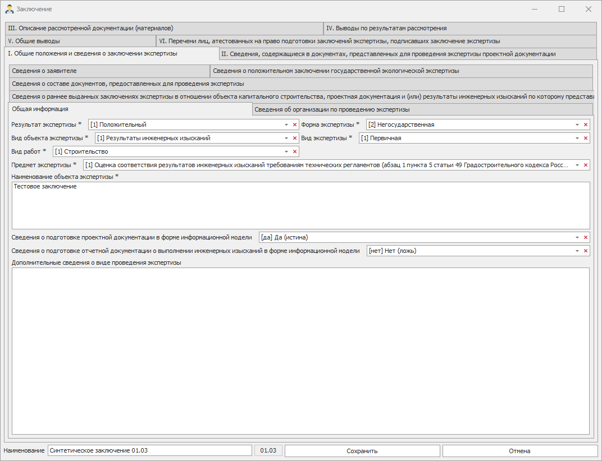

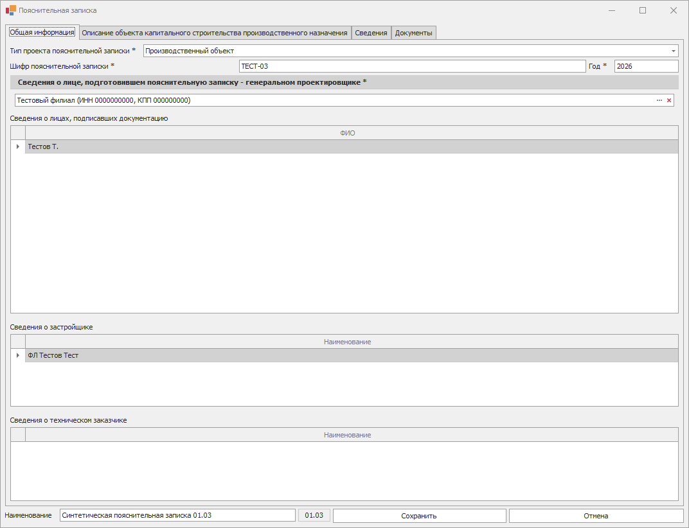

## Современные формы WinForms

1. Откройте запись 01.04 или 01.07 либо создайте новый документ. Укажите название документа.
2. Во вкладке «Разделы» выберите раздел и нужный блок. Для существующей записи откройте «Вложенные поля». Для отсутствующего блока выберите строку «Добавить» и добавьте выбранное поле. Кнопка «Назад» возвращает к родительскому блоку.
3. Во вкладке «Все поля» разверните нужный элемент в дереве XML. Справа видны значение, атрибуты и доступные дочерние поля. Чтобы создать повторяемый элемент, выделите родителя, выберите дочернее поле и нажмите «Добавить выбранное поле». При необходимости измените порядок записей кнопками «Вверх» и «Вниз».
4. Для редактирования текста откройте «Исходный XML». Нажмите «Применить XML», чтобы перенести изменения в форму. Кнопка «Вернуть текущий XML» восстанавливает текст из формы. Пока текст меняется, завершите это действие перед переходом к форме или предпросмотру.
5. Нажмите «Проверить XML». Во вкладке «Проверка XML» дважды щёлкните строку ошибки или нажмите Enter. Исправьте выделенное поле либо добавьте блок, на который указывает сообщение. После правок повторите проверку.
6. Откройте «Предпросмотр» и проверьте читаемое представление. «Обновить предпросмотр» повторно построит его по XSL.
7. Нажмите «Сохранить», чтобы записать проверенный документ в SQLite. Если работу нужно прервать до заполнения обязательных полей, используйте «Сохранить черновик XML…».

Обе вкладки формы работают с одним XML. В «Разделах» удобно последовательно заполнить реквизиты и блоки, во «Все поля» удобно сверить точное XML-имя, атрибут или повтор.

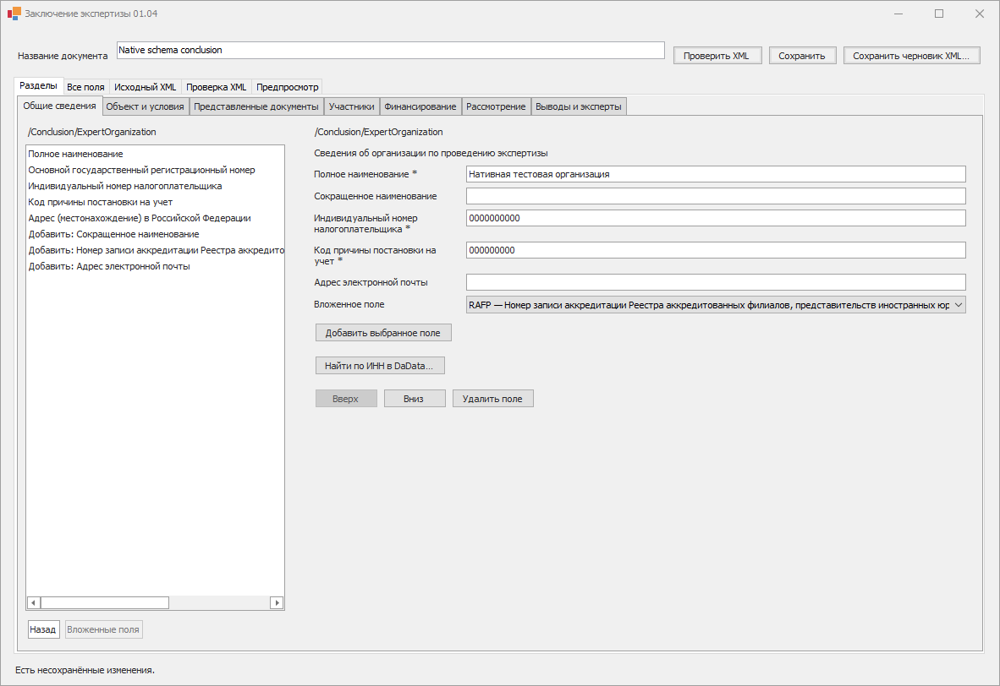

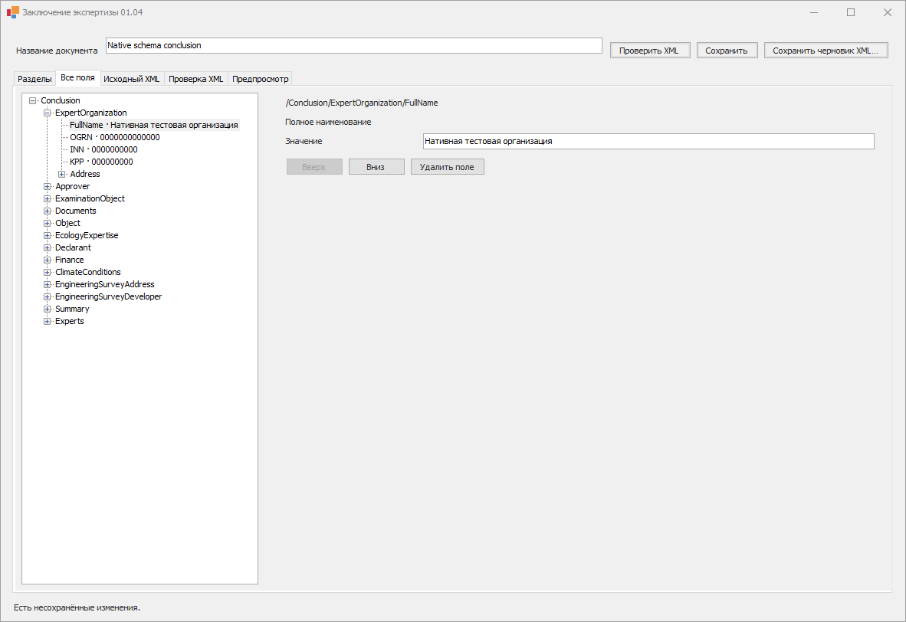

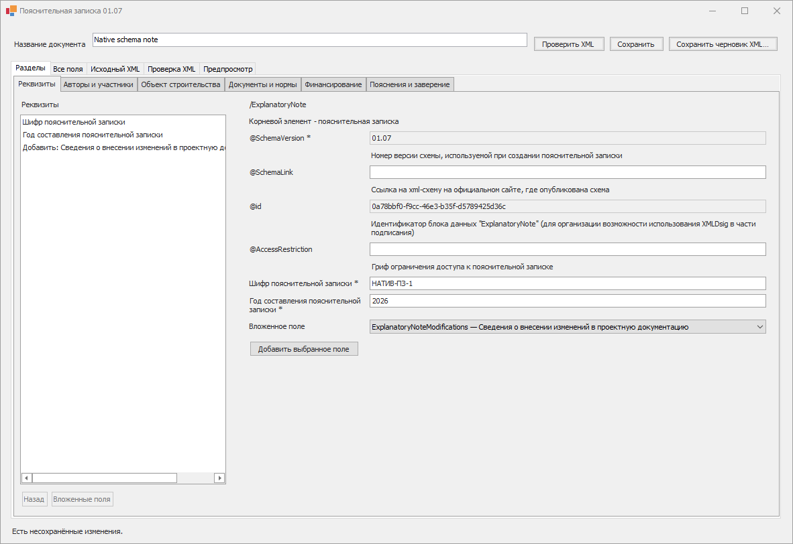

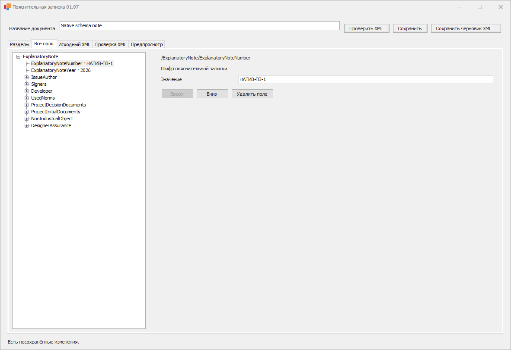

## Веб-редактор

Для обычного запуска используйте `Start-Portal.cmd`. Если порт 8765 занят, из каталога полного комплекта выполните команду с другим свободным портом.

```powershell
.\ProjectDocumentation.Schema.exe --port 8766 --open-browser
```

Используйте один профиль браузера и один адрес для работы с его черновиками. Например, `http://127.0.0.1:8765` и `http://127.0.0.1:8766` открывают отдельные хранилища. XML можно переносить через скачивание и повторное открытие.

1. В списке «Вид документа» выберите заключение или пояснительную записку. Нажмите «Новое заключение», «Новая записка» или «Открыть XML».
2. Откройте нужный раздел слева. Заполните поля со звёздочкой и поля, которые обязательны по условиям вашего документа. Для повторов нажмите «Добавить». Для взаимоисключающих вариантов выберите нужную ветку, например российский адрес или зарубежный адрес. «Сменить вариант» откроет подтверждение удаления текущей ветки.
3. Для работы с текстом нажмите «XML». Используйте «Применить XML» или «Отменить изменения XML». После этого вернитесь на вкладку «Форма».
4. Нажмите «Проверить XML». Щёлкните путь в списке ошибок, чтобы открыть нужный раздел и поле. Если ошибка относится к отсутствующей ветке, добавьте её в открывшемся разделе.
5. Нажмите «Предпросмотр» для проверки представления по XSL. После успешной проверки нажмите «Выгрузить XML». Ссылки на XSD и XSL нужной версии находятся в разделе «Файлы схемы».
6. Для паузы нажмите «Сохранить в браузере» или «Скачать черновик». Панель «Черновики» открывает сохранённые записи этого вида документа. «Скачать исходный XML» отдаёт оригинал импортированного файла. Для новых черновиков браузер сохраняет и исходные байты файла, в том числе его кодировку.

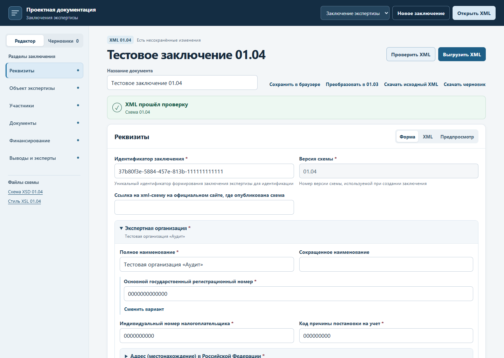

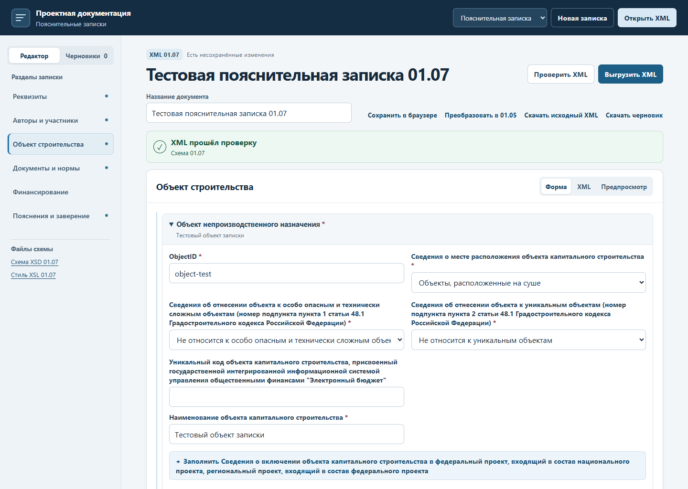

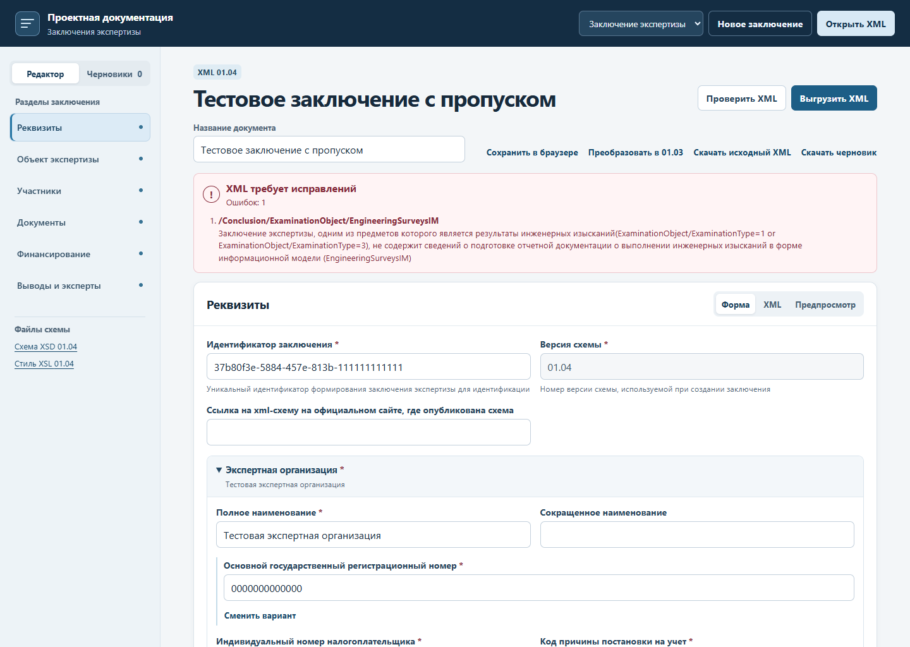

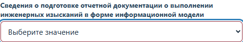

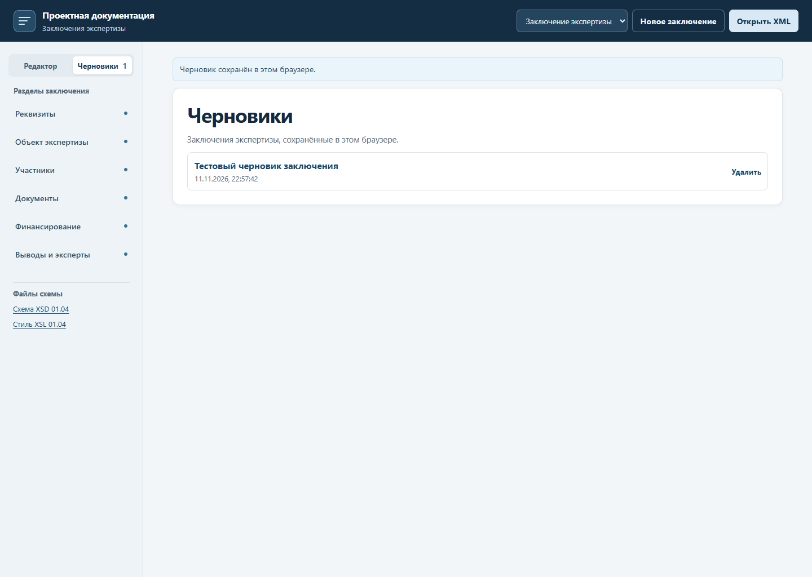

## Файлы, подписи и изображения

| Действие | Что проверять |
|---|---|
| Прикрепить файл документа | В форме документа выберите вариант с файлом. Выберите файл с диска и проверьте имя, формат и CRC32. Эти реквизиты заполняются из выбранного файла. |
| Добавить подпись | Добавьте файл подписи в блоке конкретного основного файла и проверьте его имя и CRC32. |
| Заменить основной файл | При неизменной контрольной сумме реквизиты подписей сохраняются. При изменении контрольной суммы или отсутствии предыдущей суммы приложите подписи к новому файлу. |
| Добавить изображение в записку | В подходящем текстовом блоке выберите «Изображение». Загрузите PNG, JPEG или GIF. Изображение встраивается в XML. Проверьте его в предпросмотре и при необходимости измените порядок блоков. |

В XML записываются реквизиты обычных вложений и подписей. Храните файлы комплекта вместе с выгруженным XML. Для изображений пояснительной записки редактор записывает данные изображения в XML.

В WinForms кнопки DaData заполняют доступные пустые поля по запросу. Для организации проверьте ИНН и ОГРН до применения. Для адреса проверьте регион, муниципальное образование и ОКТМО по документам. Если подсказка недоступна, заполните поля вручную.

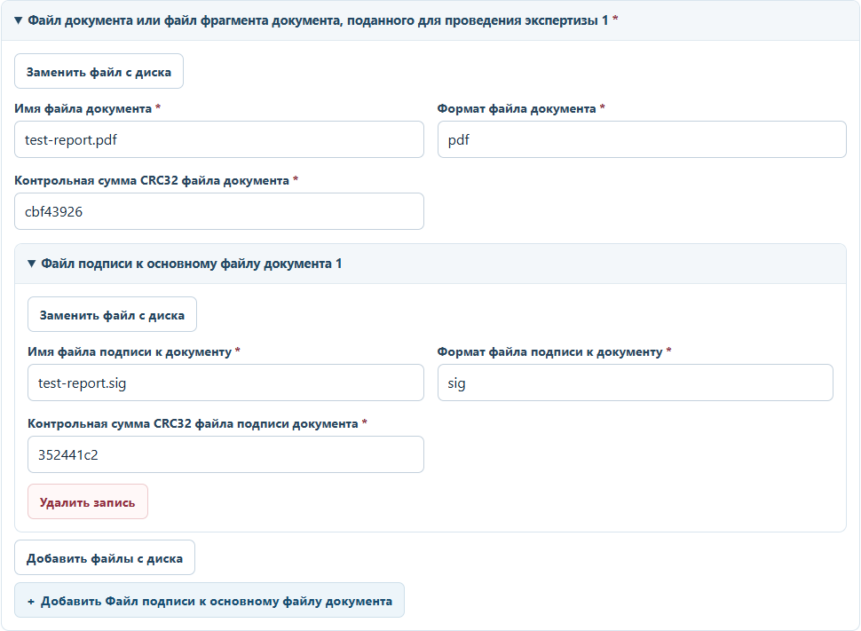

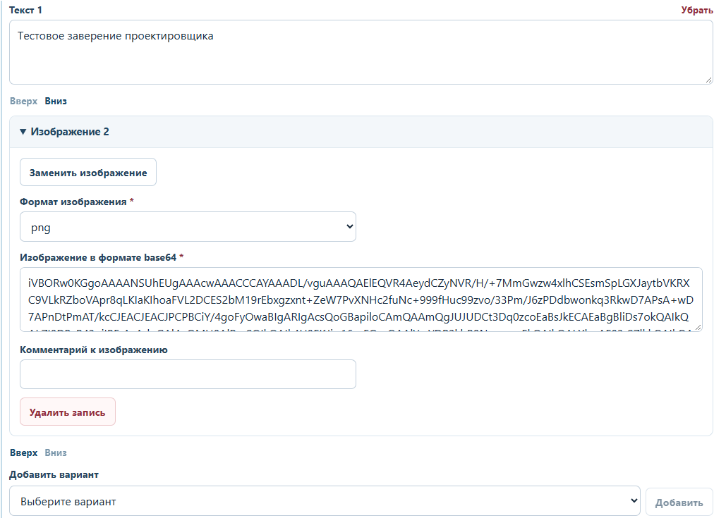

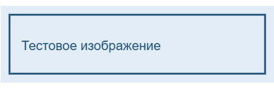

## Преобразование и выгрузка

1. Сохраните исходный XML и резервную копию базы, если документ уже находится в SQLite.
2. В WinForms выберите запись и команду преобразования. В вебе откройте XML, нажмите «Преобразовать в…», просмотрите замечания и нажмите «Открыть результат». Нажмите «Отмена», если нужно вернуться к исходному документу.
3. Сверьте перенесённые поля с исходником и заполните сведения, которые потребовала новая схема. Проверьте код назначения, ОКТМО, СНИЛС, НОПРИЗ, признаки объекта и формулировки выводов там, где они обязательны.
4. Проверьте результат и сохраните его. WinForms создаёт отдельную запись при сохранении преобразованного документа. В браузере используйте «Скачать исходный XML», чтобы иметь исходник рядом с рабочей выгрузкой.
5. Для передачи совместимой версии выберите выгрузку копии 01.03 для заключения или 01.05 для записки. В вебе сначала выгрузите актуальную версию, затем преобразуйте рабочий документ в нужную версию. Сверьте предупреждения и проверьте полученный XML по целевой схеме.

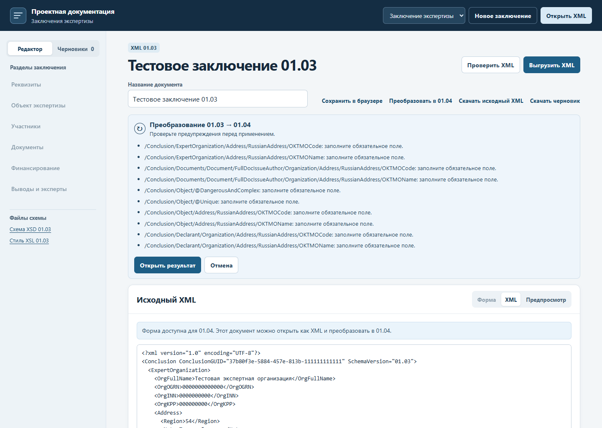

## Заполнение по разделам

В справочнике выберите вид документа и версию, затем найдите поле по его XML-имени или описанию. Если имя повторяется, сверьте тип родителя и позицию поля. Минимум и максимум указывают число повторов внутри выбранной ветки XSD. Условия, которые зависят от других полей, проверяются командой «Проверить XML». [Справочник полей и значений](fields.csv)

- [Заключение экспертизы 01.04](CONCLUSION_01_04.md)
- [Пояснительная записка 01.07](EXPLANATORY_NOTE_01_07.md)
